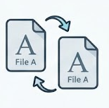

# Kopya Dosya Bulucu

Bilgisayarınızdaki aynı içerikli dosyaları bulup yönetmenize yardımcı olan bir Windows uygulaması. Dosyalarınız bilgisayarınızda kalır; tarama sonuçları çevrimiçi bir yere gönderilmez.

## Özellikler

- Sabit diskleri tarar; isterseniz USB ve harici sürücüleri de taramaya ekleyebilirsiniz.
- Dosyaları ada veya boyuta göre değil, içeriklerini karşılaştırarak eşleştirir.
- Taramayı belirli dosya türleriyle ve en küçük dosya boyutuyla sınırlandırmanıza olanak verir.
- Gizli ve sistem dosyalarını taramaya isteğe bağlı olarak dahil eder.
- Bulunan dosyaları incelemenizi, seçtiklerinizi yeniden adlandırmanızı veya başka bir klasöre taşımanızı sağlar.
- İstenmeyen kopyaları Geri Dönüşüm Kutusu'na gönderir; böylece yanlışlıkla silinen dosyaları geri alabilirsiniz.
- Tarama sonuçlarını daha sonra incelemek üzere dışa aktarır.
- Türkçe ve İngilizce arayüz seçenekleri sunar.

## İndirme

En güncel Windows sürümünü [Releases sayfasından](https://github.com/EpicError404/Ayn-DosyaBulucu/releases/latest) indirebilirsiniz. `KopyaDosyaBulucu.exe` dosyasını indirip açmanız yeterlidir; ayrıca bir kurulum yapmanız gerekmez.

## Kullanım

1. Releases sayfasından `KopyaDosyaBulucu.exe` dosyasını indirin ve açın.
2. Taramak istediğiniz sürücüleri ve dosya türlerini seçin.
3. İsterseniz en küçük dosya boyutunu veya gizli dosyaların taranıp taranmayacağını belirleyin.
4. Taramayı başlatın ve bulunan dosyaları sonuçlar bölümünde inceleyin.
5. Gerektiğinde dosyaları seçip taşıyın, yeniden adlandırın ya da Geri Dönüşüm Kutusu'na gönderin.

> **Not:** Sürücüdeki dosya sayısına ve boyutlarına bağlı olarak tarama uzun sürebilir. Silme işleminden önce seçiminizi dikkatlice kontrol edin.
